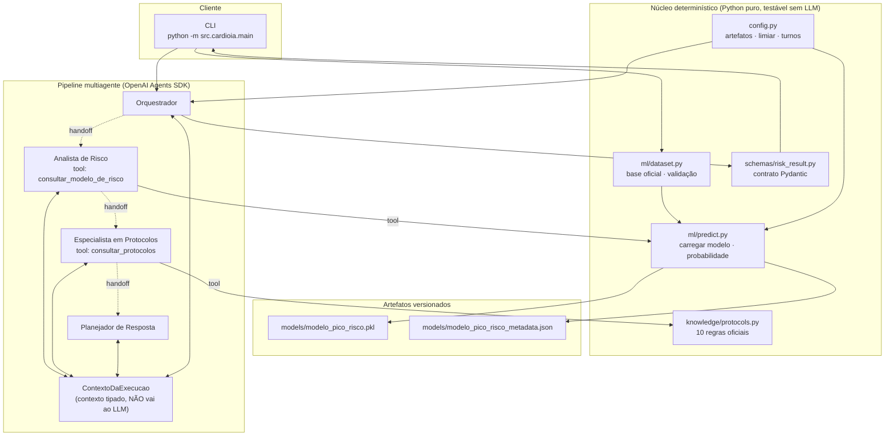

# Arquitetura multiagente 

Documento da arquitetura **implementada** 
---

## 1. Visão geral 

Um **orquestrador** executa o pipeline pelo `Runner` do SDK; quatro agentes trocam o controle por
**handoffs unidirecionais**; o LLM decide **quando** consultar e **como redigir**, enquanto
**Python** calcula e mantém todos os valores que importam (probabilidade, classe, protocolos,
justificativas), reunindo-os ao final em um **contrato Pydantic** validado.

.

## 2. Diagrama de componentes

**Leitura:** setas cheias = chamada de função Python; setas pontilhadas = **handoff** (transferência
de controle pelo SDK); `<-->` = leitura/escrita no contexto tipado.

## 3. Handoffs
:

| Origem | Destino | Tool exposta ao LLM |
|---|---|---|
| Orquestrador | Analista de Risco | `transfer_to_analista_de_risco` |
| Analista de Risco | Especialista em Protocolos | `transfer_to_especialista_em_protocolos` |
| Especialista em Protocolos | Planejador de Resposta | `transfer_to_planejador_de_resposta` |

## 4. Os agentes

| Agente | Papel no SDK | Responsabilidade | Saída esperada do LLM |
|---|---|---|---|
| **Orquestrador** | agente inicial | validar entradas, exigir o artefato, iniciar o run e montar/validar o contrato — nunca responde por conta própria | um handoff |
| **Analista de Risco** | destino do handoff #1 | chamar a tool do modelo e informar o resultado | chamada de tool + handoff |
| **Especialista em Protocolos** | destino do handoff #2 | chamar a tool dos protocolos e respeitar o que ela retornar | chamada de tool + handoff |
| **Planejador de Resposta** | destino do handoff #3, com `output_type` | consolidar narrativa, justificativas e pontos de atenção | objeto estruturado |

## 5. Ferramentas (*tools*)

| Tool | Declarada por | Implementação chamada | Efeito no contexto |
|---|---|---|---|
| `consultar_modelo_de_risco` | Analista de Risco | `ml.predict.prever_pico_risco` | grava probabilidade, classe, modelo, limiar |
| `consultar_protocolos` | Especialista em Protocolos | `knowledge.protocols.avaliar_protocolos` | grava protocolos, justificativas e indicadores |
