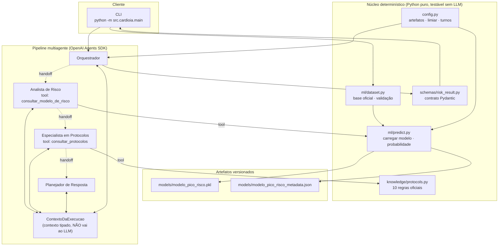
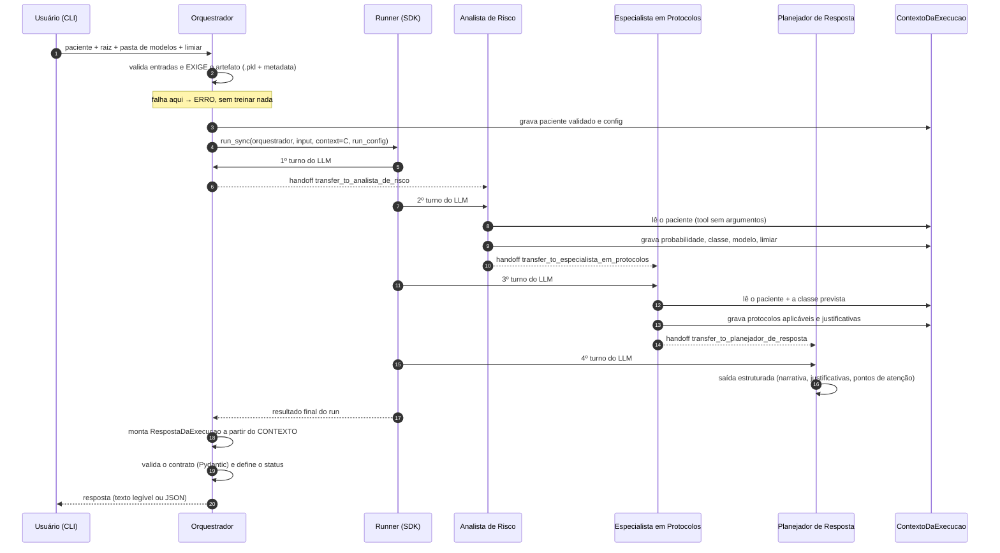
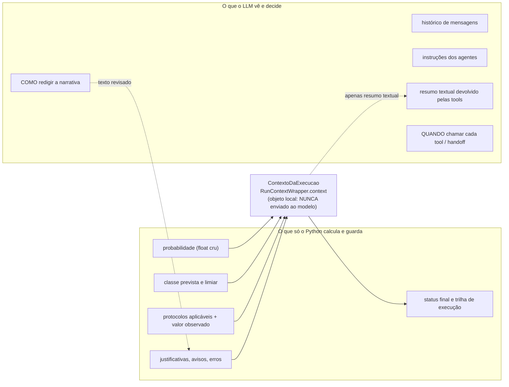
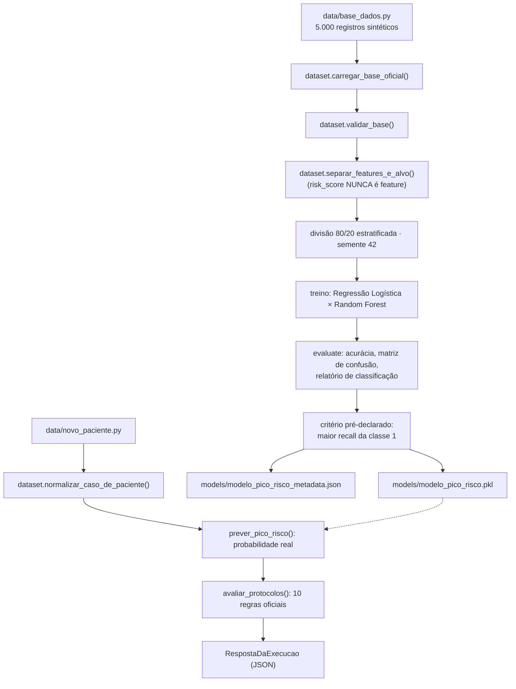
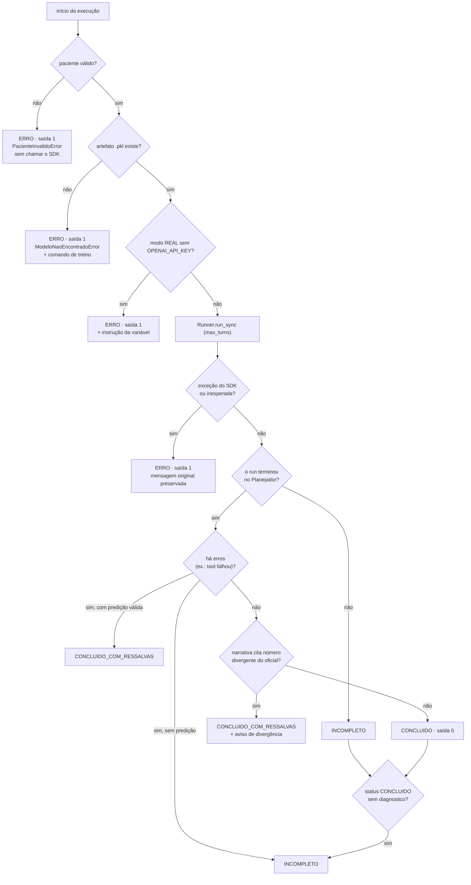

# Arquitetura multiagente — CardioIA Fase 6

Documento técnico da arquitetura **implementada** (não da arquitetura pretendida). Cada afirmação
aqui corresponde a código em `src/cardioia/**` e, quando relevante, a um teste em `tests/**`.

> Versões de referência: `openai-agents` 0.18.1 · `openai` 2.38.0 · `scikit-learn` 1.8.0 ·
> `pydantic` 2.14.1 · Python 3.13.5.

---

## 1. Visão geral em uma frase

Um **orquestrador** executa o pipeline pelo `Runner` do SDK; quatro agentes trocam o controle por
**handoffs unidirecionais**; o LLM decide **quando** consultar e **como redigir**, enquanto
**Python** calcula e mantém todos os valores que importam (probabilidade, classe, protocolos,
justificativas), reunindo-os ao final em um **contrato Pydantic** validado.

O que a arquitetura quer garantir: **nenhum número crítico depende de o LLM "lembrar" ou
"repetir" corretamente**.

## 2. Diagrama de componentes

**Leitura:** setas cheias = chamada de função Python; setas pontilhadas = **handoff** (transferência
de controle pelo SDK); `<-->` = leitura/escrita no contexto tipado.

## 3. Sequência de execução

**Pontos de controle observáveis:** `RunHooks` registra `on_agent_start`, `on_agent_end`,
`on_handoff`, `on_tool_start`, `on_tool_end` e `on_llm_start/end`; os passos relevantes vão para
`passos` e `handoffs_realizados`. O número de turnos é limitado por `max_turns` (padrão **10**).

## 4. A fronteira de confiança (o ponto mais importante)

| Propriedade | Como é garantida |
|---|---|
| O LLM não inventa números | as *tools* calculam e gravam no contexto; a resposta final lê **do contexto** |
| O LLM não altera a entrada | as *tools* **não têm parâmetros**: leem o paciente já validado no contexto |
| Texto divergente não sobrescreve | números citados na narrativa são comparados com os autoritativos; divergência gera **aviso** e status `CONCLUIDO_COM_RESSALVAS` |
| A resposta final é verificável | `RespostaDaExecucao` (Pydantic) é montada **depois** do run, em Python |

O `ContextoDaExecucao` é um `dataclass` guardado em `RunContextWrapper.context` — campo que a
documentação do SDK define como estado local do processo, disponível ao código e **não** incluído
no que é enviado ao modelo. É nele que ficam `paciente_validado`, `config`, `predicao` (resultado
cru), `protocolos`, `trilha` e `erros`.

## 5. Fluxo de dados

No caminho de **entrada do paciente**: as chaves são normalizadas
(`"disponibilidade recursos"` → `disponibilidade_recursos`), as 10 variáveis são obrigatórias e
precisam ser numéricas, e qualquer inconsistência interrompe a execução **antes** de chamar o SDK.

## 6. Handoffs

Os *handoffs* são **reais** (mecanismo do SDK) e **unidirecionais**: o controle não volta ao
orquestrador. Cada agente recebe `handoffs=[proximo_agente]`; o SDK expõe isso ao LLM como uma
função de transferência cujo nome deriva do nome do agente:

| Origem | Destino | Tool exposta ao LLM |
|---|---|---|
| Orquestrador | Analista de Risco | `transfer_to_analista_de_risco` |
| Analista de Risco | Especialista em Protocolos | `transfer_to_especialista_em_protocolos` |
| Especialista em Protocolos | Planejador de Resposta | `transfer_to_planejador_de_resposta` |

> Nomes verificados no SDK: `Agent.name` é "Analista de Risco" (com espaços) e o SDK aplica
> `Handoff.default_tool_name` (estilo de função), emitindo aviso ao transformar
> `transfer_to_Analista de Risco` em `transfer_to_analista_de_risco`.

**Por que unidirecional:** o fluxo é um pipeline com **ordem fixa** (risco → protocolos →
resposta). Permitir o retorno abriria espaço para o LLM repetir etapas ou encerrar cedo. O
`max_turns` continua ativo como rede de proteção.

## 7. Os quatro agentes

| Agente | Papel no SDK | Responsabilidade | Saída esperada do LLM |
|---|---|---|---|
| **Orquestrador** | agente inicial | validar entradas, exigir o artefato, iniciar o run e montar/validar o contrato — nunca responde por conta própria | um handoff |
| **Analista de Risco** | destino do handoff #1 | chamar a tool do modelo e informar o resultado | chamada de tool + handoff |
| **Especialista em Protocolos** | destino do handoff #2 | chamar a tool dos protocolos e respeitar o que ela retornar | chamada de tool + handoff |
| **Planejador de Resposta** | destino do handoff #3, com `output_type` | consolidar narrativa, justificativas e pontos de atenção | objeto estruturado |

Regras comuns nas instruções: não inventar valores; não arredondar; não alterar limiares; não
criar protocolos; não treinar ou simular o modelo; deixar claro que os dados são sintéticos.
Somente o **Planejador de Resposta** declara `output_type` (`ContribuicaoDoPlanejador`) — nos demais
agentes não há texto estruturado a validar, porque o que importa já está no contexto.

## 8. Ferramentas (*tools*)

| Tool | Declarada por | Implementação chamada | Efeito no contexto |
|---|---|---|---|
| `consultar_modelo_de_risco` | Analista de Risco | `ml.predict.prever_pico_risco` | grava probabilidade, classe, modelo, limiar |
| `consultar_protocolos` | Especialista em Protocolos | `knowledge.protocols.avaliar_protocolos` | grava protocolos, justificativas e indicadores |

Observações de implementação:

- **sem argumentos**, de propósito (ver §4);
- devolvem **texto legível** ao LLM (para ele poder narrar) e gravam os dados **estruturados** no
  contexto (para o Python usar);
- em caso de falha, a tool registra um passo `TipoDePasso.ERRO` com `sucesso=False` (que também vai
  para `contexto.erros`) e devolve ao LLM um texto que **proíbe** informar número
  (`FALHA: inferencia nao concluida ... Nao informe nenhuma probabilidade.`). O pipeline então
  **não** reporta predição: não existe caminho em que falha vire sucesso.

## 9. Contrato de saída

`RespostaDaExecucao` (`src/cardioia/schemas/risk_result.py`) é a **única** forma de saída:

| Campo | Papel |
|---|---|
| `status` | `CONCLUIDO` · `CONCLUIDO_COM_RESSALVAS` · `INCOMPLETO` · `ERRO` |
| `modo` | `SIMULADO` · `REAL` |
| `diagnostico` | probabilidade **crua**, classe prevista, modelo, limiar, features, origem do modelo |
| `indicadores` | indicadores ativos do paciente |
| `protocolos` | protocolos aplicáveis com condição satisfeita, valor observado e origem |
| `justificativas` | por que cada protocolo foi acionado |
| `narrativa` | texto do Planejador de Resposta (**não** autoritativo) |
| `avisos` / `erros` | divergências, limitações e falhas |
| `passos` / `handoffs_realizados` | trilha observável da execução |
| `agente_final` | quem encerrou o run |
| `limitacoes` | aviso fixo: dados sintéticos, sem validação clínica |

Validações do contrato: probabilidade restrita a `[0, 1]`; coerência entre `status` e presença de
diagnóstico/erros; `agente_final` presente quando concluído; `pico_risco_previsto` só em `{0, 1}`.

**Regra de ouro:** o campo `probabilidade_risco` **não é arredondado** no JSON —
`0.9962406015037594` aparece com precisão total. O arredondamento existe apenas nas saídas de
apresentação (texto da CLI, narrativa).

## 10. Tratamento de falhas e determinação do status

Princípios:

1. **Nunca** transformar falha em sucesso: sem predição validada, `diagnostico` é `null` e o status
   não é `CONCLUIDO`;
2. **Nunca** treinar silenciosamente: sem artefato, a execução para e instrui o comando correto;
3. Exceções (`ModeloNaoEncontradoError`, `PacienteInvalidoError`, `AgentsException` e falhas
   inesperadas) são capturadas **na fronteira** e convertidas em `ERRO` com a mensagem original
   preservada em `erros`;
4. A CLI traduz o status em código de saída (`0`, `1`, `2`), e os motivos vão para `stderr`.

## 11. Passo a passo da execução

1. A CLI lê os argumentos e localiza a raiz do projeto e a pasta de modelos.
2. O paciente é carregado (`data/novo_paciente.py` ou o arquivo JSON informado) e normalizado.
3. O orquestrador **exige** o `.pkl` e o JSON de metadados; sem eles, encerra com `ERRO`.
4. O contexto tipado é criado com paciente validado, configuração e trilha vazia.
5. `Runner.run_sync` recebe o agente orquestrador, a mensagem inicial, o contexto e o `RunConfig`
   (`tracing_disabled=True`, `max_turns`).
6. O LLM do orquestrador decide encaminhar para o **Analista de Risco** (`transfer_to_...`).
7. O Analista chama `consultar_modelo_de_risco`; a tool executa `predict` e grava o resultado.
8. O handoff seguinte leva ao **Especialista em Protocolos**, que chama `consultar_protocolos`.
9. O último handoff leva ao **Planejador de Resposta**, que devolve a saída estruturada.
10. O orquestrador lê o **contexto** e monta a `RespostaDaExecucao`.
11. A narrativa é comparada com os números autoritativos (divergência ⇒ aviso).
12. O contrato é validado; a CLI imprime texto legível ou JSON e retorna o código de saída.

## 12. Problemas encontrados e soluções

Todos os itens abaixo foram **observados na implementação** (comando, erro ou teste que
reproduz), não são hipóteses.

| # | Problema | Sintoma observado | Solução adotada |
|---|---|---|---|
| 1 | `RunConfig(model_provider=None)` sobrescrevia a *factory* padrão do SDK | `AttributeError: get_model` no primeiro run | montar o `RunConfig` **somente** com os campos significativos |
| 2 | Nome de agente com espaços vira tool de handoff inválida | aviso do SDK transformando `transfer_to_Analista de Risco` | nomes derivados pelo próprio SDK (`transfer_to_analista_de_risco`); documentado e verificado |
| 3 | Tentação de extrair a probabilidade do **texto** do LLM | ruído de formatação | ler sempre do **contexto tipado**; texto é só apresentação |
| 4 | Vínculo protocolo↔regra por busca textual aproximada | risco de casar a regra errada se o arquivo mudar | **lista fixa por posição validada**; falha explícita quando o texto oficial muda |
| 5 | Probabilidade arredondada antes da decisão | erro perto do limiar (0,5) | arredondar **somente na apresentação**; a decisão usa a probabilidade crua |
| 6 | Artefato com `pasta_modelos` **absoluto** (`C:\Users\...`) | JSON versionado amarrado à máquina do autor | gravar caminho **relativo** à raiz (ou só o nome da pasta) — `.pkl` com SHA-256 idêntico antes/depois |
| 7 | `pydantic` do SDK (≥2.12.2) × `gradio` (<2.12) | dependências mutuamente insatisfazíveis | **documentado** com alternativas; **não** declarado resolvido |
| 8 | Custo de API impedindo exercitar o fluxo | testes de integração caros/limitados | `modelo_simulado` determinístico + suíte que não usa API |
| 9 | Cota da conta OpenAI | `HTTP 429 / insufficient_quota` no modo real | falha **propagada como `ERRO`** e registrada como limitação (nunca como sucesso) |

## 13. Decisões de projeto e justificativas

| Decisão | Justificativa |
|---|---|
| O LLM **não** calcula nada | auditabilidade e reprodutibilidade: números vêm de código determinístico |
| *Tools* **sem parâmetros** | impede o LLM de alterar as entradas do caso |
| Handoffs **unidirecionais** | pipeline com ordem fixa; evita repetição e encerramento prematuro |
| Contexto **tipado** e local | o SDK garante que `context` não é enviado ao modelo |
| `output_type` só no Planejador | é o único que produz texto a estruturar; nos demais o dado já está no contexto |
| Resposta final montada em Python | o contrato é validado **antes** de sair do processo |
| `tracing_disabled=True` | não enviar dados do caso para a plataforma de observabilidade |
| Constantes em `config.py` | eliminar duplicação de nomes de artefato entre `train` e `predict` |
| `modelo_simulado` determinístico | exercitar SDK, handoffs e tools sem custo e sem rede |
| Protocolos lidos do arquivo oficial | manter a camada determinística fiel ao material da aula, com teste de coerência |

---

Documentos relacionados: [`relatorio_tecnico.md`](relatorio_tecnico.md) ·
[`plano_implementacao.md`](plano_implementacao.md) · [`../README.md`](../README.md).